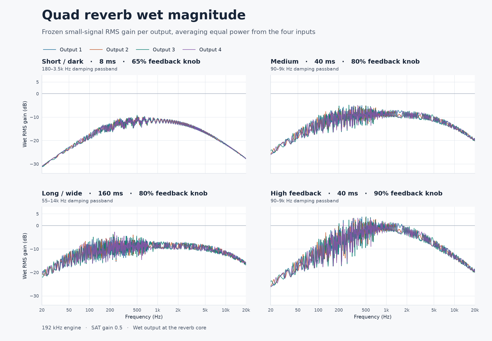
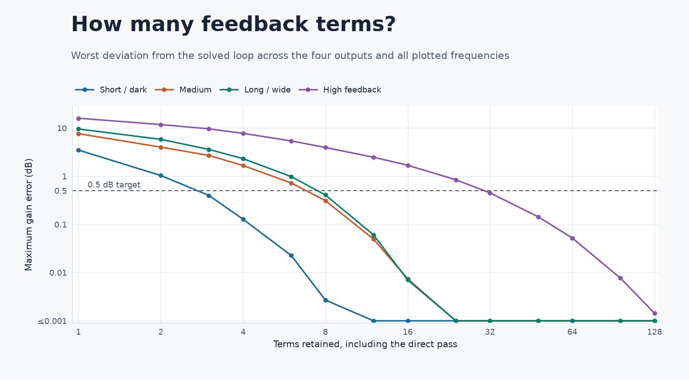
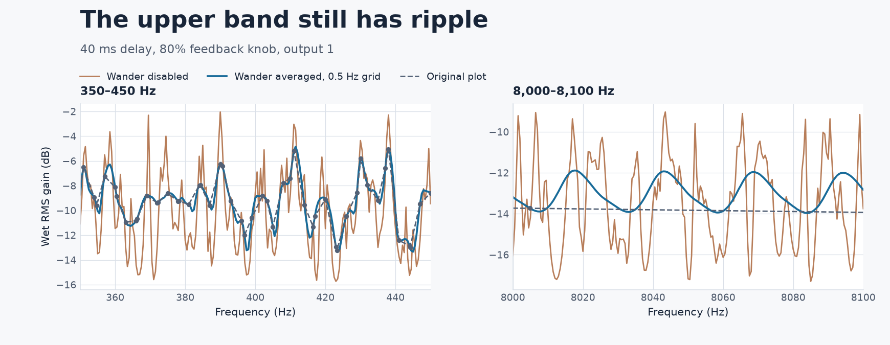

# Frozen Quad Reverb response

The model freezes the forty per-lane clocks and linearizes the wet core at silence. It uses the production main and all-pass tap positions, cubic interpolation, Givens mixer, high-pass and low-pass damping, and the saturation slope. The probability model uses independent ideal clocks with the stationary wandering LFO law.

Lean checks the stationary LFO law, the frozen-runtime refinement and small-signal response under its stability hypotheses, and the whole-loop expected transfer with a geometric truncation bound. The per-output RMS curves below use deterministic quadrature in the same frozen model. Refining the quadrature gives an empirical error check. The accuracy of the freeze approximation for continuously moving taps remains an open question.

- [Stationary LFO law](../../../formal/DSP/WanderingRandomLFO/Distribution.lean)
- [Frozen runtime and expectation](../../../formal/DSP/Filters/SquiggleBoyQuadReverb/Frozen/WanderExpectation.lean)
- [Reverb-specific loop and truncation bounds](../../../formal/DSP/Filters/SquiggleBoyQuadReverb/Frozen/WanderBounds.lean)

## Magnitude

For output lane $i$, the curve shows $10\log_{10}(\frac14\sum_j\mathbb E|H_{ij}|^2)$ in dB. This is the wet gain with equal power from the four uncorrelated inputs. The engine rate is 192 kHz and the SAT gain is 0.5 in every case. Delay values are nominal and the production widening applies independently to each lane. The delay offset is centered.



The reference solves the four-by-four loop at each quadrature node. Intro power factors out of the tank integral by independence. The scalar stationary law integrates the uniform B-spline knot phase and the four independent uniform knots. We used 645 frequencies and 8,192 to 65,536 deterministic tank quadrature nodes per frequency. Doubling the node count changed the reference by at most 0.15 dB across the four presets and outputs.

## Terms for 0.5 dB

The term count includes the direct pass. The observed error is taken over all sampled frequencies and outputs. The analytical budget is sufficient across 20 Hz to 20 kHz for series truncation.

| Setting | Feedback knob | First tested count within 0.5 dB | Worst error at that count | Analytical budget |
|---|---:|---:|---:|---:|
| 8 ms, 180 Hz to 3.5 kHz | 65% | 3 | 0.40 dB | 4 |
| 40 ms, 90 Hz to 9 kHz | 80% | 8 | 0.31 dB | 10 |
| 160 ms, 55 Hz to 14 kHz | 80% | 8 | 0.41 dB | 10 |
| 40 ms, 90 Hz to 9 kHz | 90% | 32 | 0.45 dB | 77 |



Write $G$ for the single-pass tank, $D$ for the diagonal intro transfer, and $R$ for the loop return. In these presets the feedback coefficient is equal across the lanes, so $R$ is a scalar multiple of $G$ and commutes with it. The truncation identity becomes $H-H_N=H D^{-1}R^N D$. If $\|R\|_2\le r<1$, each row therefore has relative error at most $\kappa(D)r^N$. Taking the RMS across the frozen clock law preserves the bound.

With angular frequency $\omega$ in radians per engine sample, write $\delta=(1-\cos\omega)^2(3+(1-\cos\omega)/2)/16$. The cubic tap has squared magnitude at least $1-\delta$. This bounds an all-pass with gain 0.6 below by $\sqrt{1-4\delta}$ in magnitude. The eight intro stages give $\kappa(D)\le(1-4\delta)^{-4}$. A relative RMS error at most $1-10^{-0.5/20}$ is sufficient for 0.5 dB. The budget uses an upper bound for the peak damping gain on each frequency interval and the cubic loss at its upper endpoint.

## Ripple

In the 40 ms, 80% feedback case, the median across the four outputs of the local 5th-to-95th percentile gain range was 6.5 dB at 350–450 Hz and 2.1 dB at 8,000–8,100 Hz after removing the local linear slope. With wander disabled it was 7.0 dB in the upper window. The denser check uses a 0.5 Hz grid. The original plot sampled the upper window at one point, so its interpolating line hides most of that ripple.



## Reproduce

From the repository root, run the scripts with NumPy, SciPy and Matplotlib installed.

```sh
python3 docs/experiments/reverb-frozen/evaluate.py
python3 docs/experiments/reverb-frozen/check_ripple.py
python3 docs/experiments/reverb-frozen/plot.py
```

The scripts write the figures, frequency grids, results and CSV under the ignored directory `build/results/reverb-magnitude/`.
